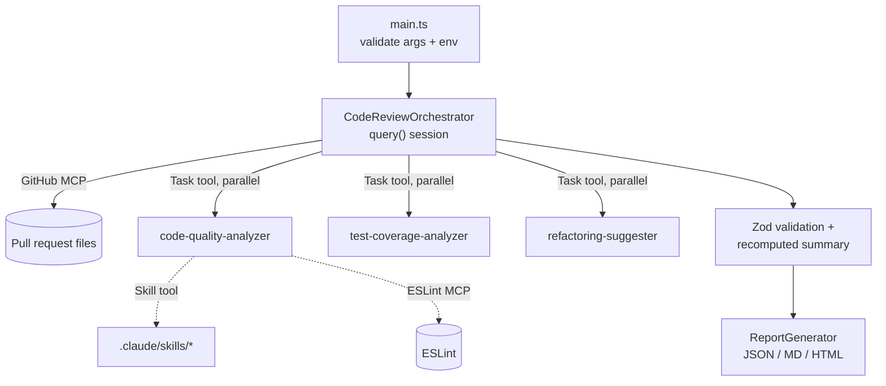

# Enterprise Multi-Agent Code Review Orchestrator

An automated pull-request reviewer built on the **Claude Agent SDK**. One
orchestrator session reads a GitHub PR, delegates every changed source file to
three specialised subagents, and returns a schema-validated report in JSON,
Markdown and HTML.

## How it works



| Requirement | Where it lives |
|---|---|
| Agent SDK `query()` orchestration | `src/orchestrator.ts` |
| Three subagents (`AgentDefinition`) | `src/agents/*.ts` |
| Prompts as separate templates | `src/prompts/*.prompt.ts` |
| MCP servers (GitHub, ESLint) | `src/config/mcp.config.ts` |
| Claude Skills (4) | `.claude/skills/*/SKILL.md` |
| Structured output (JSON Schema + Zod) | `src/types/*`, `outputFormat` in the orchestrator |
| Rate limiting, retries, timeouts, logging | `src/utils/*` |
| Tests | `tests/*.test.ts` |

### Design decisions

- **Read-only reviewer.** `Bash`, `Write` and `Edit` are disallowed; the agents
  can only read files, use skills, and call the two MCP servers.
- **The model does not do the arithmetic.** After the SDK returns structured
  output, `finalizeReport()` validates it with Zod and recomputes the summary
  (totals, average score, critical issues, high-priority tests) from the
  per-file results, so the numbers always agree with the findings.
- **Retries only where they can help.** Timeouts and configuration errors fail
  immediately; transient and schema failures are retried with exponential
  backoff and jitter.
- **Real cancellation.** The timeout aborts the SDK session through an
  `AbortController` instead of just ignoring it.
- **Rate-limit slots are always released**, including on failure, using actual
  token usage when the SDK reports it.
- **HTML output is escaped**, because its content comes from a model reading
  untrusted pull-request code.

## Setup

Requires Node.js 18+ (20+ recommended), an Anthropic API key (or Bedrock
credentials) and, for private repos or higher rate limits, a GitHub token.

```bash
npm install            # uses the committed package-lock.json
cp .env.example .env   # then edit it
```

Important `.env` values:

```bash
ANTHROPIC_API_KEY=sk-ant-...        # not needed in the Vocareum workspace
ANTHROPIC_MODEL=claude-sonnet-4-5-20250929   # a shell variable with the same name overrides this
PROJECT_ROOT=/absolute/path/to/this/repo   # must contain .claude/skills (run `pwd` in the repo root)
GITHUB_TOKEN=ghp_...                # recommended
LOG_LEVEL=info
```

## Usage

```bash
npm run dev <owner> <repo> <pr-number>
# example
npm run dev octocat Hello-World 1
```

Production build:

```bash
npm run build
npm start <owner> <repo> <pr-number>
```

Reports are written to `reports/` as `<owner>-<repo>-<pr>-<timestamp>.{json,md,html}`.
Logs go to `logs/combined.log` and `logs/error.log`.

### Generating the submission reports

Runs the agent on the three Task 6.1 pull requests and writes the `.json`,
`.md` and `.html` files to `reports/`. Commit them exactly as generated.

```bash
npm run review:todo
# or one at a time
npm run dev udacity cd14715-simple-todo-app 1
```

## Tests

```bash
npm test          # all unit tests (no network or API key needed)
npm run lint      # type-check only
```

The orchestrator tests inject a fake `query()` so they cover success, retry,
retry exhaustion, timeout, invalid input, missing skills directory, schema
failure and rate-limit cleanup without calling the API.

## Skills

| Skill | Used for |
|---|---|
| `javascript-best-practices` | `.js` / `.jsx` files |
| `typescript-patterns` | `.ts` / `.tsx` files |
| `python-code-review` | `.py` files |
| `security-analysis` | every file (OWASP Top 10) |

## Troubleshooting

- **"No .claude/skills directory found"** — `PROJECT_ROOT` must be the absolute path of this project.
- **GitHub errors / 403** — check that `GITHUB_TOKEN` has `repo` scope.
- **`npm install` fails with an `edgesOut` error** (an npm 10 peer-dependency resolver bug) — the included `.npmrc` normally handles it; otherwise run `npm install --legacy-peer-deps`.
- **The model does not change when you edit `.env`** — an `ANTHROPIC_MODEL` already set in your shell wins. Override per run: `ANTHROPIC_MODEL=claude-sonnet-4-5-20250929 npm run dev <owner> <repo> <pr>`.
- **`Agent session finished` shows `subagentCalls: 0`** — check `deniedTools` in that log line; the agent was not allowed to use a tool.
- **Structured output failed** — the model's JSON did not match `src/types/`; the run is retried once automatically.

## Limitations

- The review quality depends on the model; findings should be read by a human before acting.
- Cost and duration scale with the number of changed files (three subagent runs per file). Use `maxBudgetUsd` and `maxTurns` in `OrchestratorOptions` to cap a run.
- No authentication layer is included; wrap it if you expose it as a service.

## License

ISC
